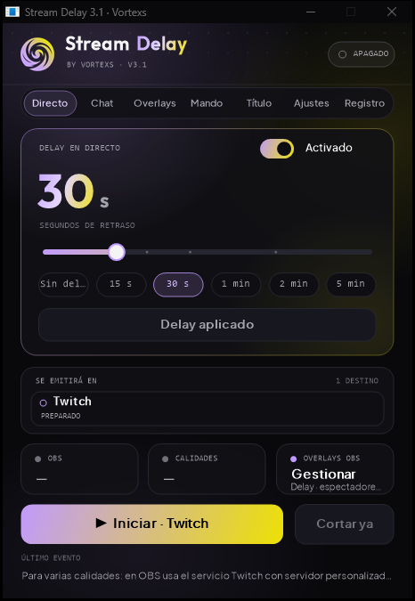
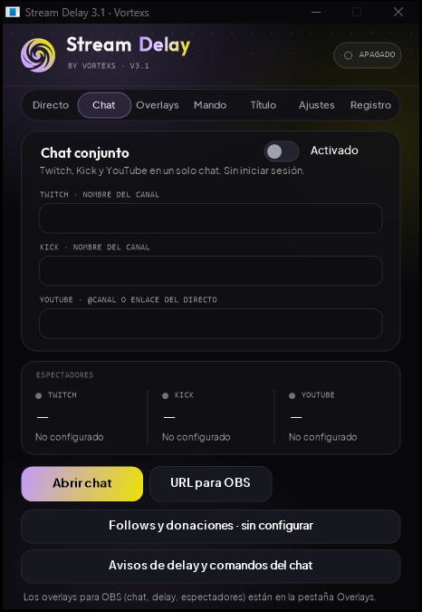
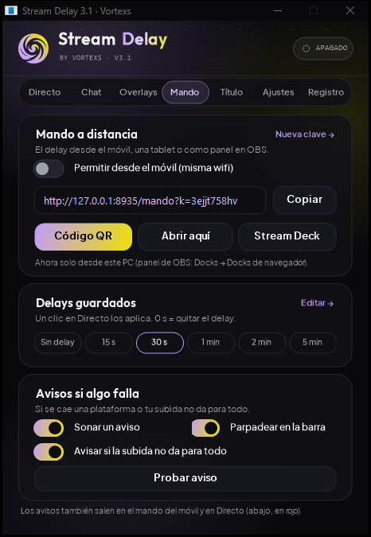

# StreamDelay

**Delay dinámico y gratuito para tus directos con OBS** · *Free dynamic stream delay for OBS*

OBS envía el directo a StreamDelay, que lo retrasa los segundos que elijas y lo reenvía a Twitch, Kick, YouTube o cualquier servidor RTMP. El delay se puede cambiar, activar o quitar **en pleno directo**, sin cortar el stream.

**Web:** [manuelferjo.github.io/StreamDelay](https://manuelferjo.github.io/StreamDelay/) · **Descarga:** [última versión](https://github.com/manuelferjo/StreamDelay/releases/latest)

<p align="center">
  
  
  
</p>

## Funciones

- **Delay dinámico**: elige los segundos y cámbialos en directo. Al subirlo se repiten los últimos segundos emitidos; al bajarlo, el stream salta hacia delante. Atajos de teclado globales.
- **Multistream**: Twitch, Kick, YouTube y otro destino a la vez, con el mismo delay. OBS codifica una sola vez.
- **Varias calidades en Twitch** (Transmisión mejorada de OBS).
- **Chat conjunto** de Twitch, Kick, YouTube y TikTok (TikTok con una clave gratuita de [Euler Stream](https://www.eulerstream.com)) con emotes de 7TV, BetterTTV y FrankerFaceZ, avisos de subs, regalos, raids, bits, Super Chats, follows y donaciones (StreamElements y Streamlabs), espectadores de cada plataforma, escribir en todos los chats a la vez, moderar (borrar, expulsar, banear y deshacer, modo lento, borrar el chat) y moderación automática (palabras prohibidas, enlaces, spam, bots).
- **Mando** desde el móvil, el Stream Deck o un panel de OBS.
- **Overlays** para OBS: delay, espectadores y chat en pantalla, personalizables (el chat con su propio estilo: fuente, tamaño, colores, con o sin fondo…).
- **Título y categoría** en Twitch, Kick y YouTube a la vez.
- Ligero: el vídeo no se vuelve a codificar (casi no usa CPU).

## Descarga

Descarga la última versión en **[Releases](https://github.com/manuelferjo/StreamDelay/releases)**, descomprime el ZIP y abre `StreamDelay.exe`. La guía completa está en `GUIA.html`, dentro del ZIP.

Requisitos: Windows 10 u 11 y OBS Studio.

> **Aviso de Windows:** StreamDelay todavía no tiene firma digital, así que la primera vez que lo abras Windows puede mostrar «Windows protegió su PC». Pulsa **Más información → Ejecutar de todas formas**. Solo pasa con la primera descarga: las actualizaciones automáticas no lo muestran. Más detalles en [Firma digital](#firma-digital).

## Compilar desde el código

No hace falta instalar nada: `build.bat` usa el compilador de C# (.NET Framework 4) que ya trae Windows.

```
build.bat
```

Crea `StreamDelay.exe` en la misma carpeta. El código está en `src/` y los recursos (página del chat, overlays, fuentes, icono) en `res/`.

La ventana principal (`MainForm`) está repartida en un archivo por pestaña: `LiveTab.cs` (Directo), `ChatTab.cs`, `Extras.cs` (Overlays), `Remote.cs` (Mando), `TitleTab.cs`, `SettingsTab.cs` y, en `MainForm.cs`, lo común (Registro, atajos y `StreamDelay.ini`). El resumen está al principio de `MainForm.cs`.

GitHub compila el programa y pasa las pruebas del chat con cada cambio (pestaña **Actions**). Para comprobar que un cambio de limpieza no altera nada, `pruebas/ILDiff.cs` compara dos `.exe` instrucción por instrucción (ver `pruebas/LEEME.txt`).

La web está en `web/` y se publica sola en GitHub Pages al subir cambios (`.github/workflows/web.yml`).

## Publicar una versión

1. Cambia `Version` en `src/MainForm.cs` (por ejemplo a `3.1`) y añade las novedades al `LEEME.txt`.
2. Sube los cambios a GitHub.
3. En **Releases → Draft a new release**, crea la etiqueta `v3.1` (la misma versión con una `v` delante) y pulsa **Publish release**.

GitHub compila, comprueba que la versión coincide con la etiqueta y **adjunta el ZIP de descarga a la Release** él solo.

## Firma digital

StreamDelay **todavía no está firmado digitalmente**: los certificados de firma de código son de pago, y el programa gratuito de SignPath para código abierto solo admite proyectos más conocidos (se volverá a pedir más adelante).

Por eso Windows puede avisar la primera vez que abres el `.exe` descargado («Windows protegió su PC» → **Más información → Ejecutar de todas formas**). Para que puedas fiarte igualmente:

- Todo el código está en este repositorio, y el ZIP de cada [Release](https://github.com/manuelferjo/StreamDelay/releases) lo compila **GitHub Actions** a partir de él (puedes ver cada compilación en la pestaña **Actions**).
- Cada ZIP tiene su huella **SHA-256** en la página de la Release. El actualizador automático la comprueba antes de instalar nada.
- Si lo prefieres, puedes compilarlo tú mismo con `build.bat` (ver arriba).

*English:* StreamDelay isn't code-signed yet, so Windows SmartScreen may warn the first time you run the downloaded `.exe` (click **More info → Run anyway**). Every release ZIP is built from this repository's source by GitHub Actions and has its SHA-256 shown on the release page; automatic updates don't show the warning.

## Privacy policy

This program will not transfer any information to other networked systems unless specifically requested by the user or the person installing or operating it. StreamDelay only connects to the streaming platforms and services that the user configures (Twitch, Kick, YouTube, StreamElements, Streamlabs, and emote providers 7TV, BetterTTV and FrankerFaceZ). Keys and tokens are stored locally, encrypted with Windows DPAPI for the current Windows user; nothing is sent to the developer.

## English summary

StreamDelay is a free Windows tool for streamers. OBS sends the stream to StreamDelay, which delays it by a configurable number of seconds (changeable live, without restarting the stream) and forwards it to Twitch, Kick, YouTube or any RTMP server at the same time. It also includes a unified chat for Twitch, Kick and YouTube with 7TV/BTTV/FFZ emotes, a phone remote control and OBS overlays. The user interface is in Spanish.

## Licencia

[MIT](LICENSE) · Las fuentes incluidas (Outfit, Plus Jakarta Sans y JetBrains Mono) usan la licencia SIL Open Font License 1.1 (`res/OFL-*.txt`).
